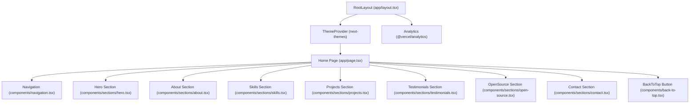
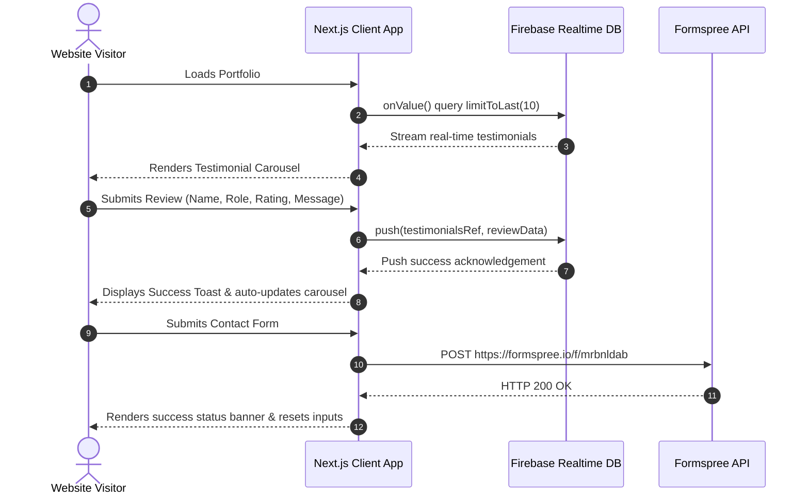

# Project Documentation: Mohammed Masood Azhar Portfolio (Next.js)

**Author & Developer:** Mohammed Masood Azhar  
**Role:** Associate Software Developer (Front-End) | React & TypeScript Specialist  
**Live Production URL:** [https://masood-portfolio-nextjs.vercel.app](https://masood-portfolio-nextjs.vercel.app)  
**Repository:** [https://github.com/MasQuantumCoder-34/masood_portfolio_nextjs.git](https://github.com/MasQuantumCoder-34/masood_portfolio_nextjs.git)  

---

## 1. Executive Summary & Project Purpose

The **Mohammed Masood Azhar Portfolio** is a modern, high-performance, responsive single-page web application engineered to showcase front-end engineering expertise, production projects, professional background, open-source repositories, and client testimonials.

### Core Value Propositions:
- **Interactive & Modern UI/UX:** Built with a dark navy/indigo glassmorphic aesthetic, floating 3D-style typography, mouse-following radial gradient effects, and smooth micro-interactions.
- **Production Performance:** Built on Next.js 16 (App Router) with React 19 and Tailwind CSS v4, achieving near-instant load times and optimized client-side hydration.
- **Real-Time Client Feedback:** Integrates Firebase Realtime Database for live testimonial collection and dynamic display with star ratings and timestamp formatting.
- **Contact Pipeline:** Direct contact form integrated with Formspree for serverless email forwarding with validation and toast notifications.
- **SEO & Social Optimization:** Pre-configured dynamic OpenGraph tags, Twitter summary cards, canonical URL alternates, `robots.ts`, and dynamic XML `sitemap.ts`.

---

## 2. Technology Stack & Architectural Decisions

### 2.1 Core Framework & Runtime
| Layer | Technology | Version | Purpose |
| :--- | :--- | :--- | :--- |
| **Framework** | [Next.js](https://nextjs.org/) | `16.0.7` | App Router architecture, Server Components, SEO optimization, and static generation. |
| **Library** | [React](https://react.dev/) | `19.2.0` | Declarative UI rendering, hooks, and concurrent features. |
| **Language** | [TypeScript](https://www.typescriptlang.org/) | `^5` | Strict static typing across all components, interfaces, and hooks. |
| **Package Manager** | [pnpm](https://pnpm.io/) / [npm](https://www.npmjs.com/) | `12.x / 11.x` | Deterministic dependency management. |

### 2.2 Styling, Design System & Animations
- **Tailwind CSS v4 (`^4.1.9`)**: Utilizes modern `@theme inline` declarations, CSS custom properties, and OKLCH color spaces for high-gamut, mathematically consistent color rendering.
- **`tw-animate-css` (`1.3.3`) & `tailwindcss-animate` (`^1.0.7`)**: Micro-animations, float cycles, and shimmer effects.
- **Glassmorphism Design Tokens**: Custom `.glass` and `.glass-dark` utility classes with `backdrop-blur-md` and semi-transparent borders.
- **Next Themes (`^0.4.6`)**: Client-side theme switching (configured default to Dark theme).
- **Lucide React (`^0.454.0`)**: Lightweight, tree-shakable SVG icon library.

### 2.3 UI Component Library (shadcn/ui Foundation)
- Comprehensive Radix UI primitive suite configured via `components.json` (New York style):
  - `@radix-ui/react-dialog`, `@radix-ui/react-dropdown-menu`, `@radix-ui/react-accordion`, `@radix-ui/react-avatar`, `@radix-ui/react-tooltip`, `@radix-ui/react-toast`, etc.
  - Class merge utility (`lib/utils.ts`) combining `clsx` and `tailwind-merge`.

### 2.4 Backend Services & External Integrations
- **Firebase v12 (`^12.6.0`)**: Firebase Realtime Database (`getDatabase`) for dynamic real-time testimonial management (`/testimonials` node).
- **Formspree**: RESTful contact form endpoint (`https://formspree.io/f/mrbnldab`) handling spam protection and direct email alerts.
- **Vercel Analytics (`@vercel/analytics`)**: Lightweight telemetry measuring real user experience and web vitals.

---

## 3. High-Level Architecture & Flow Diagrams

### 3.1 Component Hierarchy


### 3.2 Data Flow & External Service Integrations


---

## 4. Codebase Directory Structure

```plaintext
masood_portfolio_nextjs/
├── .env.example               # Environment variables template for Firebase configuration
├── .gitignore                  # Git ignore rules for node_modules, .next, and local env files
├── components.json             # shadcn/ui configuration file (New York style, RSC enabled)
├── next-env.d.ts               # Next.js TypeScript ambient type declarations
├── next.config.mjs             # Next.js compiler & image configuration
├── package.json                # Project dependencies, metadata, and build scripts
├── postcss.config.mjs          # PostCSS configuration with Tailwind CSS plugin
├── tsconfig.json               # TypeScript compiler flags, paths, and strict checking
├── app/
│   ├── globals.css             # Tailwind v4 theme, OKLCH colors, keyframes & glass utility classes
│   ├── layout.tsx              # Root HTML shell, Metadata, SEO definitions, ThemeProvider, Analytics
│   ├── page.tsx                # Main SPA page composing all visual sections
│   ├── robots.ts               # Dynamic robots.txt generation allowing crawler indexing
│   └── sitemap.ts              # Dynamic sitemap.xml route generator
├── components/
│   ├── back-to-top.tsx         # Floating scroll-to-top trigger button (visible > 400px)
│   ├── navigation.tsx          # Floating navbar with IntersectionObserver scroll spy & theme toggle
│   ├── theme-provider.tsx      # Dark/light theme context provider powered by next-themes
│   ├── sections/
│   │   ├── hero.tsx            # Hero presentation with mouse-reactive radial spotlight & quick stats
│   │   ├── about.tsx           # Biography, achievement highlights, and professional timeline
│   │   ├── skills.tsx          # Interactive skills matrix divided into Frontend, Backend, and Tools
│   │   ├── projects.tsx        # Projects grid with automatic 3-second ImageSlideshow components
│   │   ├── testimonials.tsx    # Firebase RTDB real-time reviews reader, submitter & auto-carousel
│   │   ├── open-source.tsx     # GitHub open-source repositories showcase with stats
│   │   └── contact.tsx         # Contact form linked to Formspree + social channel direct links
│   └── ui/                     # Comprehensive Radix/shadcn component kit (accordion, buttons, etc.)
├── hooks/
│   ├── use-mobile.ts           # Custom React hook to detect mobile viewport (< 768px)
│   └── use-toast.ts            # Toast notification management hook
├── lib/
│   ├── firebase.ts             # Firebase application initialization & Realtime Database instance getter
│   └── utils.ts                # Class merging utility (clsx + tailwind-merge)
└── public/
    ├── icon.svg                # Favicon and brand mark
    ├── resume.pdf              # Downloadable curriculum vitae / resume
    ├── placeholder-user.jpg    # Fallback avatar image for testimonials
    ├── mufar_tech_1.png ...    # High-resolution screenshots of showcased client and enterprise systems
    └── *.jpg, *.png            # Portfolio imagery and visual project assets
```

---

## 5. Detailed Component & Module Breakdown

### 5.1 Root Layout & Global Metadata (`app/layout.tsx`)
- **Metadata Configuration:**
  - Dynamic title with template (`"%s | Mohammed Azhar"`).
  - OpenGraph cards (`og:type`, `locale: "en_US"`, base URL: `https://masood-portfolio-nextjs.vercel.app`).
  - Twitter Card format (`summary_large_image`).
  - Canonical URL alternates mapped to root `/`.
- **Hydration & Theming:**
  - Sets `suppressHydrationWarning` on `<html>`.
  - Wraps children inside `<ThemeProvider attribute="class" defaultTheme="dark" enableSystem={false}>`.
  - Injects `<Analytics />` from `@vercel/analytics/next` at the layout level for telemetry.

### 5.2 Header & Navigation (`components/navigation.tsx`)
- **Scroll Monitoring:** Triggers `scrolled` state when `window.scrollY > 50`, dynamically applying `glass backdrop-blur-xl border-b border-white/10`.
- **Scroll Spy via IntersectionObserver:** Monitors sections (`#about`, `#skills`, `#projects`, `#testimonials`) with `threshold: 0.3` to automatically highlight the current active navigation link.
- **Theme Switcher:** Toggles between `dark` and `light` with Lucide icons (`Sun` / `Moon`), with client-mount checks to prevent hydration mismatch.
- **Direct Anchor Navigation:** Contact button directs to `#contact` with smooth CSS scrolling.

### 5.3 Hero Section (`components/sections/hero.tsx`)
- **Interactive Mouse Follower:** Tracks client `(x, y)` cursor coordinates and translates a blurred radial gradient bubble (`blur-3xl`) with smooth easing (`0.8s ease-out`).
- **Floating 3D Typography:** Custom CSS keyframe animation (`.float`) creating subtle vertical bobbing.
- **Call-to-Action Controls:**
  - `View My Work`: Smoothly scrolls to `#projects`.
  - `Get In Touch`: Smoothly scrolls to `#contact`.
  - `Resume`: Direct download link pointing to `/resume.pdf`.
- **Metrics Display:** Responsive 3-card stats panel showcasing total projects, professional experience, and core technology count.

### 5.4 About & Career Journey (`components/sections/about.tsx`)
- **Key Metrics Grid:** 4-column glass cards for delivered projects, clients, technologies, and academic certifications.
- **Career Timeline:** Structured milestones:
  1. *Associate Software Developer (Front-End)* — DataTerrain Private Limited (React, TypeScript, Redux, RTK Query).
  2. *On-site Internship* — IWAVY Technology Solutions (Payroll Management, PHP, MySQL).
  3. *E-commerce Final Year Project* — Islamiah College.
  4. *B.Sc. Computer Science Graduate* — Islamiah College (Autonomous), First Class Distinction.

### 5.5 Skills Matrix (`components/sections/skills.tsx`)
- **Interactive Tab Navigation:** Dynamically toggles between `Frontend`, `Backend`, and `Tools & DevOps`.
- **Visual Progress Indicators:** Render skill proficiency percentages (e.g., React 90%, TypeScript 88%, Git 88%) with animated gradient progress bars.

### 5.6 Project Showcase (`components/sections/projects.tsx`)
- **Embedded Slideshow (`ImageSlideshow`):** Self-contained slideshow cycling through multi-frame screenshots every 3 seconds via `setInterval` and cross-fade opacity transitions.
- **Featured Projects:**
  1. **MufarTech Website** — Live company website (Next.js, React, TypeScript, Tailwind).
  2. **Mufar Tech Tasks** — Real-time collaborative task manager.
  3. **Mufar Tech Forms** — Dynamic form generation and data collection engine.
  4. **Mufar Tech CRM** — Customer relationship management and pipeline dashboard.
  5. **Mufar Central Enterprises** — Confidential enterprise ERP solution featuring inventory, billing, and reporting.

### 5.7 Testimonials & Live Review Engine (`components/sections/testimonials.tsx`)
- **Real-Time Database Synchronization:**
  - Listens to Firebase Realtime Database node `testimonials` sorted by `createdAt` with `limitToLast(10)`.
  - Automatically reverses the payload to present the newest reviews first.
- **Review Submission Modal:**
  - Collects Author Name, Professional Role/Company, Star Rating (1 to 5), and review text.
  - Automatically attaches ISO timestamps and default avatar fallback.
- **Carousel Automation:** 5-second interval auto-rotation with manual dot navigation (pauses upon user interaction).
- **Date Humanization (`formatDate`):** Categorizes timestamps into "Today at HH:MM AM/PM", "Yesterday at HH:MM AM/PM", or localized dates.
- **Floating Toast Notification System:** Custom animated toast notifications displaying success/error states without external runtime dependencies.

### 5.8 Open Source Repositories (`components/sections/open-source.tsx`)
- Displays open-source projects hosted under GitHub organization/user `MasQuantumCoder-34`.
- Cards render language indicators, stargazers, forks, and external link hover triggers.

### 5.9 Contact Pipeline (`components/sections/contact.tsx`)
- **Form Integration:** Submits full name, email, subject, and message to Formspree endpoint (`https://formspree.io/f/mrbnldab`).
- **Validation & Feedback:** Inline validation checking for required fields, loading states on the submit button, and clear success/failure status banners.
- **Direct Contact Links:** GitHub, LinkedIn, Direct Phone (`tel:`), and Direct Email (`mailto:`).

### 5.10 Back-to-Top Component (`components/back-to-top.tsx`)
- Window scroll listener activating opacity and translate-y transitions when `window.scrollY > 400`.
- Executes `window.scrollTo({ top: 0, behavior: "smooth" })`.

---

## 6. Firebase Realtime Database Specification

### 6.1 Database Schema (`testimonials` node)
Each testimonial document under the `testimonials` node has the following JSON structure:

```json
{
  "testimonials": {
    "-O1abcdef123456789": {
      "author": "John Doe",
      "role": "Product Manager at TechCorp",
      "rating": 5,
      "text": "Mohammed delivered exceptional front-end code with flawless performance.",
      "avatar": "/placeholder-user.jpg",
      "createdAt": "2026-11-05T10:30:00.000Z"
    }
  }
}
```

### 6.2 Firebase Database Security Rules (Recommended)
To permit anonymous reading and verified submissions while preventing malicious deletions or arbitrary node writes, use the following rules in your Firebase Console:

```json
{
  "rules": {
    "testimonials": {
      ".read": true,
      ".indexOn": ["createdAt"],
      "$testimonial_id": {
        ".write": "!data.exists() && newData.exists()",
        ".validate": "newData.hasChildren(['author', 'role', 'rating', 'text', 'createdAt']) && newData.child('rating').isNumber() && newData.child('rating').val() >= 1 && newData.child('rating').val() <= 5 && newData.child('text').val().length <= 1000"
      }
    }
  }
}
```

---

## 7. Environment Variables Configuration

Create a `.env.local` file in `masood_portfolio_nextjs` based on `.env.example`:

| Environment Variable | Description | Example / Required Format |
| :--- | :--- | :--- |
| `NEXT_PUBLIC_FIREBASE_API_KEY` | Firebase Web API Key | `AIzaSyD...` |
| `NEXT_PUBLIC_FIREBASE_AUTH_DOMAIN` | Firebase Auth Domain | `your-project.firebaseapp.com` |
| `NEXT_PUBLIC_FIREBASE_DATABASE_URL` | Firebase Realtime Database URL | `https://your-project-default-rtdb.firebaseio.com` |
| `NEXT_PUBLIC_FIREBASE_PROJECT_ID` | GCP / Firebase Project ID | `your-project-id` |
| `NEXT_PUBLIC_FIREBASE_STORAGE_BUCKET`| Firebase Storage Bucket URL | `your-project.appspot.com` |
| `NEXT_PUBLIC_FIREBASE_MESSAGING_SENDER_ID` | Cloud Messaging Sender ID | `123456789012` |
| `NEXT_PUBLIC_FIREBASE_APP_ID` | Firebase App ID | `1:123456789012:web:abcdef` |

> **Note:** If Firebase environment variables are omitted or undefined, `getFirebaseDatabase()` gracefully returns `null`, and the portfolio displays a friendly prompt to leave a review without throwing runtime errors.

---

## 8. Installation & Local Development Guide

### 8.1 Prerequisites
- **Node.js**: `v20.x` or higher (verified compatible with Node `v24.15.0`)
- **Package Manager**: `pnpm` (recommended) or `npm` / `yarn`
- **Git**

### 8.2 Step-by-Step Setup

1. **Clone or Navigate to the Workspace:**
   ```bash
   cd c:\Projects\NewOrganizations\Mass_Portfolio\masood_portfolio_nextjs
   ```

2. **Configure Environment:**
   ```bash
   cp .env.example .env.local
   # Fill in your Firebase credentials in .env.local
   ```

3. **Install Dependencies:**
   ```bash
   pnpm install
   # or
   npm install
   ```

4. **Launch the Development Server:**
   ```bash
   pnpm run dev
   # or
   npm run dev
   ```
   Open [http://localhost:3000](http://localhost:3000) in your browser.

5. **Build for Production:**
   ```bash
   pnpm run build
   # or
   npm run build
   ```

6. **Run Production Server Locally:**
   ```bash
   pnpm run start
   # or
   npm run start
   ```

---

## 9. Next.js Configuration (`next.config.mjs`)

```javascript
/** @type {import('next').NextConfig} */
const nextConfig = {
  typescript: {
    // Allows production builds to succeed during continuous integration
    ignoreBuildErrors: true,
  },
  images: {
    // Enables unoptimized static image serving for static exports or specialized CDNs
    unoptimized: true,
  },
}

export default nextConfig
```

---

## 10. Deployment & Hosting Guide (Vercel)

The portfolio is architected for zero-configuration continuous deployment on [Vercel](https://vercel.com).

### Deployment Steps:
1. Push your latest code changes to your GitHub repository:
   ```bash
   git add .
   git commit -m "docs: complete project documentation"
   git push origin main
   ```
2. Log in to your [Vercel Dashboard](https://vercel.com).
3. Import the repository `MasQuantumCoder-34/masood_portfolio_nextjs`.
4. Under **Root Directory**, leave as default (or select `masood_portfolio_nextjs` if deploying from the parent repo).
5. In **Environment Variables**, paste all `NEXT_PUBLIC_FIREBASE_*` keys from `.env.local`.
6. Click **Deploy**. Vercel will automatically build and distribute the app across global edge networks.
7. Vercel Web Analytics will automatically activate using the included `@vercel/analytics` package.

---

## 11. Maintenance & Extensibility Guide

### 11.1 Adding a New Project
To feature a new project, edit `components/sections/projects.tsx`:
1. Add project screenshots (e.g. `new_project_1.png`) into the `public/` folder.
2. In `projects` array, append a new object:
   ```typescript
   {
     title: "Project Name",
     description: "Summary of project goals and implementation.",
     tags: ["Next.js", "TypeScript", "Tailwind CSS"],
     images: ["/new_project_1.png", "/new_project_2.png"],
     link: "https://your-project-link.vercel.app",
     featured: true, // Optional: spans wider column on medium viewports
     confidential: false, // Set to true to disable external hyperlink
   }
   ```

### 11.2 Updating Skills & Proficiencies
To adjust or add skills, update the `skillsData` object in `components/sections/skills.tsx`. Adjust the percentage value (0 to 100) and the category (`frontend`, `backend`, or `tools`).

### 11.3 Updating Resume
Replace `public/resume.pdf` with your updated PDF resume. The download link in `components/sections/hero.tsx` automatically serves whatever file is placed at that path.

---

*Documentation compiled and maintained for Mohammed Masood Azhar Portfolio.*
